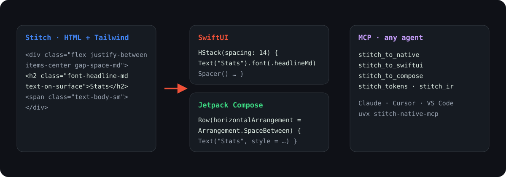

<p align="center"></p>
<h1 align="center">stitch-native</h1>
<p align="center">Google Stitch screens → native <b>SwiftUI</b> and <b>Jetpack Compose</b>. CLI + MCP server.</p>
<p align="center">
<a href="https://github.com/rafaelcsan705/stitch-native/actions/workflows/ci.yml"></a>


</p>



## Quick start

```bash
uvx --from git+https://github.com/rafaelcsan705/stitch-native stitch-native swiftui screen.html > Screen.swift
```

## Add to your agent

| Client | Config |
|---|---|
| Claude Code | `claude mcp add stitch-native -- uvx --from git+https://github.com/rafaelcsan705/stitch-native stitch-native-mcp` |
| Claude Desktop / Cursor / VS Code | see JSON below |

```json
{ "mcpServers": { "stitch-native": {
  "command": "uvx",
  "args": ["--from", "git+https://github.com/rafaelcsan705/stitch-native", "stitch-native-mcp"] } } }
```

Tools: `stitch_to_native`, `stitch_to_swiftui`, `stitch_to_compose`, `stitch_tokens`, `stitch_ir` (source: `html`, `path` or `url`). Prompt: `convert_screen`. Resources: token-map and IR docs.

## How it works

```
Stitch HTML + tailwind.config  →  DOM  →  IR (JSON: box / text / icon / image + styles)  →  emitter
```

1. Reads the Tailwind theme Stitch embeds (`colors`, `spacing`, `borderRadius`, `fontFamily`, `fontSize`).
2. Resolves each element's classes into a small layout IR (row / column / grid, padding, gap, radius, borders, text styles).
3. Emits SwiftUI or Compose. Colours that are not theme tokens are reported as off-token literals.

## Usage

```bash
python3 stitch_native.py swiftui  screen.html --name MatchStatsView    > MatchStatsView.swift
python3 stitch_native.py compose  screen.html --name MatchStatsScreen  > MatchStatsScreen.kt
python3 stitch_native.py tokens        screen.html > StitchTheme.swift
python3 stitch_native.py tokens-kotlin screen.html > StitchTheme.kt
python3 stitch_native.py ir            screen.html > screen.ir.json

# State mode: stateless screen + State struct/sample, keys, callbacks (no ViewModel)
python3 stitch_native.py swiftui fixtures/fornada-encomendas.html --name OrdersListView   --mode state
python3 stitch_native.py compose fixtures/fornada-encomendas.html --name OrdersListScreen --mode state
```

`--mode state` reads `locale`, `timeZone`, `currency` and key prefixes from `stitch-native.json`. Plug the screen into your own ViewModel/Coordinator: it only takes `state` and callbacks.

### Map tokens to your design system

```json
{ "colors": { "primary": "DS.Color.accent", "#12241c": "DS.Color.card" },
  "fonts":  { "headline-md": "DS.Font.title" } }
```

```bash
python3 stitch_native.py init screen.html      # writes stitch-native.json, lists unmapped tokens/icons
python3 stitch_native.py swiftui screen.html   # auto-loads ./stitch-native.json (or --config path)
```

`stitch-native.json` also takes `icons` (Material → SF Symbol), `iconsCompose`
(Material → `Icons.X.Y`), `preview.colorScheme` and `output` folders. `null` entries fall back to the theme.

## MCP server

`stitch_native_mcp.py` exposes the converter to any MCP client (stdio, no dependencies).

```bash
claude mcp add stitch-native -- python3 /path/to/stitch_native_mcp.py
```

| Tool | Does |
|---|---|
| `extract_tokens` | Theme file for `swiftui` or `compose` |
| `stitch_to_ir` | Layout IR as JSON |
| `stitch_to_swiftui` | SwiftUI view + off-token report |
| `stitch_to_compose` | Compose composable + off-token report |
| `stitch_to_native` | Both platforms in one call |
| `init_config` | `stitch-native.json` skeleton + unmapped list |

Each tool takes `html` (the export) or `path`; the code tools also take `name` and `config` (object) or `config_path`.
Pairs well with the official Stitch MCP: fetch the screen HTML there, convert here.

## Example

`fixtures/match-stats.html` → [`examples/MatchStatsView.swift`](examples/MatchStatsView.swift) and [`examples/MatchStatsScreen.kt`](examples/MatchStatsScreen.kt).

## Status

Prototype. Known gaps:

- Output not yet compile-checked in CI.
- SwiftUI drops the font weight when a family token and a `text-*` size class share an element.
- Absolute positioning, animations and `hover:` states are ignored.

Roadmap: `visual_diff` tool (render vs Stitch screenshot) and a Claude skill.

## License

MIT
